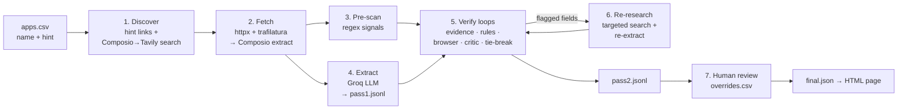

# Composio App Research Agent

An agent that researches **100 apps** the way Composio does before building a toolkit. For each app it finds:
- the auth method
- whether developers can get credentials themselves or need approval
- the API surface and whether an MCP server exists
- whether a toolkit can be built today

Every answer comes with a docs URL and a quote copied word for word from that page. The agent's answers are then checked by verification loops and a human, and accuracy is measured against hand-labelled ground truth.

> **Build status:** the project is built in phases. Commands that are not built yet are marked *(Phase N)*.

| Phase | What | Status |
|---|---|---|
| 0 | Setup, config, schema, smoke test | ✅ done |
| 1 | 20-app evaluation sample + hand labels | ✅ done |
| 2 | Discover + fetch + pre-scan (no LLM) | ✅ built (re-run once the Tavily key is added) |
| 3 | Extraction, Pass 1 | 🛠 running (prompt tuned on 5 non-holdout test apps: GitHub, Plaid, PitchBook, Sherlock, Otter AI) |
| 4 | Verification loops + re-research, Pass 2 | ⬜ |
| 5 | Human review + accuracy scoring | ⬜ |
| 6 | Pattern analysis + HTML page | ⬜ |
| 7 | GitHub Actions + GitHub Pages deploy | ⬜ |

---

## 1. Quick start

### Requirements
- Python 3.11+ (developed on 3.13)
- Free accounts and API keys:

| Key | Where to get it | Used for |
|---|---|---|
| `COMPOSIO_API_KEY` | https://platform.composio.dev → Settings → API keys | runs every search/extract call; Composio toolkit catalogue |
| `TAVILY_API_KEY` | https://app.tavily.com → API Keys (free, 1,000 searches/month) | the search engine behind Composio's `TAVILY_SEARCH`; the agent connects it to Composio automatically on first run |
| `GROQ_API_KEY` | https://console.groq.com/keys | extractor and critic LLMs |
| `GEMINI_API_KEY` | https://aistudio.google.com/apikey | tie-breaker LLM (optional; Groq backs it up) |

No paid plan is needed for any of them.

> **Why Tavily?** Composio's own free search toolkit (`COMPOSIO_SEARCH`) is retired: every version returns HTTP 410. So the agent connects a free Tavily key to Composio as a connected account and still searches *through the Composio SDK*. See [docs/composio_friction.md](docs/composio_friction.md).

### Install (Windows PowerShell)
```powershell
cd research-agent
python -m venv .venv
.\.venv\Scripts\python -m pip install -r requirements.txt
.\.venv\Scripts\python -m playwright install chromium   # browser loop (Phase 4)
Copy-Item .env.example .env                              # then paste your 3 keys into .env
```

### Install (macOS / Linux)
```bash
cd research-agent
python3 -m venv .venv
source .venv/bin/activate
pip install -r requirements.txt
playwright install chromium
cp .env.example .env        # then paste your 3 keys into .env
```

### Check that everything works
```powershell
.\.venv\Scripts\python -m agent.smoke_test
```
Expected output:
```
[OK]      schema    100 apps, 10 categories, schema round-trips
[OK]      tiktoken  o200k_base ok ...
[OK]      composio  toolkit lookup ok: github
[OK]      groq      qwen/qwen3.8-27b -> 'OK'
[OK]      groq      openai/gpt-oss-20b -> 'OK'
[OK]      groq      openai/gpt-oss-120b -> 'OK'
[OK]      gemini    gemini-3.8-flash -> 'OK'
All checks passed.
```
The smoke test makes **one tiny call per key and per model**. That proves the keys, the model names and the SDK versions are all valid before any real work starts. It never prints your keys. Each Gemini check uses 1 of the roughly 20 free Gemini requests per day.

> The commands below use `.\.venv\Scripts\python` (Windows). On macOS/Linux, activate the venv and use `python`.

---

## 2. How the agent works

### The flow for one app



| Step | File | Uses an LLM? | What it does and why |
|---|---|---|---|
| 1. Discover | `agent/discover.py` | No | Starts from the hint URL and the docs-looking links on that page. Then runs 4 web searches through Composio → Tavily: "{app} API authentication", "{app} developer API docs", "{app} API pricing access partner program" and "{app} MCP server". Ranks URLs with plain rules (official domain +5, docs-like path words up to +4, Tavily relevance up to +2; forums and SEO sites dropped) and keeps 6: hint first, then the best hit of each query, then the rest by score. |
| 2. Fetch | `agent/fetch.py` | No | Downloads each page with `httpx` + `trafilatura`. That's free, and gives a real HTTP status for the evidence check. Thin pages (under 500 chars, JS shells, bot walls) are retried with Composio → Tavily extract, which renders JS. Pages still thin are marked `needs_browser`. Then it builds the app's **docs bundle**: the most keyword-dense paragraphs, up to ~3K tokens, with each page's best paragraph picked first. |
| 3. Pre-scan | `agent/prescan.py` | No | Keyword regexes over the **full** pages (`oauth`, `api key`, `partner program`, `contact sales`, `mcp`, `graphql`, and so on). Gives a second opinion that involves no LLM. |
| 4. Extract | `agent/extract.py` *(Phase 3)* | **Groq** | One call per app. The model reads the trimmed docs (~3K tokens: the paragraphs with the most auth/pricing/partner keywords) and fills the schema. Every field must cite a provided URL and quote the page word for word. Anything not stated becomes `unknown`; the model must never guess. The output is saved as **Pass 1** and never changed afterwards. |
| 5. Verify | `agent/verify.py` *(Phase 4)* | Groq + Gemini | Five checks, described below. Every check is logged to `results/verification_log.jsonl`. |
| 6. Re-research | `agent/rerun.py` *(Phase 4)* | Groq | For flagged fields only: runs extra targeted searches, fetches new pages, re-extracts just those fields, and verifies again. Max 2 rounds. Fields still unresolved are marked `needs_human`. The result is **Pass 2**. |
| 7. Human | `eval/human_overrides.csv` *(Phase 5)* | No | A person reviews every `needs_human` row and records corrections with evidence. The HTML page lists every override, so it is clear exactly where a human was needed. |

### The verification loops (step 5)

| # | Loop | How it checks | Catches |
|---|---|---|---|
| 1 | **Evidence** (code) | Is the cited URL one we actually fetched, and did it load? Is the quote really on that page (fuzzy match ≥ 90%)? | Invented or misquoted evidence |
| 2 | **Rules** (code) | The verdict is recomputed from rules and compared with the LLM's own verdict. Claims are compared with the pre-scan signals, e.g. "OAuth2" claimed but the word `oauth` appears nowhere in the pages. | Internal contradictions |
| 3 | **Browser** (Playwright) | Re-opens `needs_browser` pages in headless Chromium, then re-extracts | Pages that only render with JavaScript |
| 4 | **Critic** (Groq `gpt-oss-120b`) | A *different* model reads each claim and its quote and answers `supported`, `contradicted` or `not_enough_info` | Claims the quote doesn't actually support |
| 5 | **Tie-breaker** (Gemini) | Runs only where the extractor and critic still disagree after re-research | Final call on disputed fields |

### Which model does what

| Role | Model (default) | Why this one |
|---|---|---|
| Extractor | Groq `qwen/qwen3.8-27b`, then `openai/gpt-oss-20b` | Free. Each Groq model has its own daily quota, so when the first model runs out for the day the next one takes over. |
| Critic | Groq `openai/gpt-oss-120b` | A different model from the extractor, so its check is independent |
| Tie-breaker | Gemini `gemini-3.8-flash` → `gemini-3.6-flash` → a Groq backup | Different provider entirely. If Gemini is overloaded (HTTP 503), it falls back down the chain. |

All models are set in `.env`, so you can swap one without touching code.

### Verdict rules
The LLM does not decide the buildability verdict; code does:
- **ready:** credentials are self-serve (free or trial), there is a REST or GraphQL API, and the auth method is known
- **ready_with_friction:** needs a paid plan or admin/app review, or the app is SDK/CLI-only but usable
- **blocked:** partner programme, contact sales, no public API, or no API at all

---

## 3. How accuracy is measured

1. `eval/score.py` picks **20 apps**, 2 per category, using a fixed random seed (42). It rebuilds the same 20 every time, so the sample isn't stored as a file. `python -m eval.score --make-sample` prints it.
2. A human labelled those 20 **by hand from the real docs, before seeing any agent output**, in [eval/ground_truth.csv](eval/ground_truth.csv).
3. Ten of the 20 are a **holdout**. Prompts can be tuned while looking at the other 10, never at the holdout, so the holdout score is an honest one.
4. *(Phase 5)* `eval/score.py` scores **Pass 1 → Pass 2 → Final** against the hand labels for each field: auth methods, access, API type, MCP and verdict. The score report shows how much the verification loops and human review improved accuracy, and lists every miss.

---

## 4. Commands

| Command | What it does | Available |
|---|---|---|
| `python -m agent.smoke_test` | Checks every key and model | ✅ now |
| `python -m agent.run --all --prep` | Phase 2: discover + fetch + pre-scan + Composio toolkit check → `results/phase2_report.csv` | ✅ now |
| `python -m agent.discover --app Linear` (also `agent.fetch`, `agent.prescan`) | Run one step alone | ✅ now |
| `python -m eval.score --make-sample` | Prints the 20-app sample and holdout split (never touches `ground_truth.csv`) | ✅ now |
| `python -m agent.run --app "Linear" --extract` | Extract one app; prints JSON, writes nothing | ✅ now |
| `python -m agent.run --ids 1-10 --pass 1` | Pass 1 for a range of apps (append-only) | ✅ now |
| `python -m agent.run --all --pass 1` | Pass 1 for all 100 → `results/pass1.jsonl` | ✅ now |
| `python -m agent.run --all --verify` | Verification loops + re-research → `results/pass2.jsonl` | Phase 4 |
| `python -m agent.run --finalize` | Applies human overrides → `results/final.json` / `.csv` | Phase 5 |
| `python -m eval.score` | Accuracy report → `eval/scores.json` | Phase 5 |
| `python -m analysis.patterns` | Patterns and stats → `analysis/patterns.json` | Phase 6 |
| `python site/build.py` | Builds `site/index.html` | Phase 6 |

**Runs can be resumed:** apps already in the output file are skipped unless you pass `--force`. **Everything is cached** (searches, pages, LLM answers), so re-running costs no quota.

---

## 5. Free-tier budget (and why runs span ~2 days)

| Limit | Value per model | Effect on the design |
|---|---|---|
| Groq tokens/minute | 8,000 | One request (prompt + answer) must fit inside it → each app gets about 3K tokens of docs, and each request is capped at about 6.5K tokens in total |
| Groq tokens/day | 200,000 | About 30 extractions per model per day. Two extractor models give about 60/day, so **Pass 1 for 100 apps takes ~2 days** |
| Gemini requests/day | ~20 | Gemini is used only for tie-breaks, capped at 18/day |

When every model has hit its daily cap, the run stops cleanly. Run the same command the next day and it continues where it left off.

---

## 6. Configuration (`.env`)

Only the three keys are required. Everything else has a default in `agent/config.py`.

| Variable | Default | Meaning |
|---|---|---|
| `EXTRACT_MODELS` | `qwen/qwen3.8-27b,openai/gpt-oss-20b` | Extractor models, tried in order |
| `CRITIC_MODEL` | `openai/gpt-oss-120b` | Must differ from the extractor |
| `GEMINI_MODEL` / `GEMINI_FALLBACK_MODEL` | `gemini-3.8-flash` / `gemini-3.6-flash` | Tie-breaker chain |
| `TIEBREAK_BACKUP_MODELS` | `openai/gpt-oss-20b,qwen/qwen3.8-27b` | Groq backup if Gemini is down |
| `GROQ_RPM/RPD/TPM/TPD` | 30 / 1000 / 8000 / 200000 | Free-plan limits per model |
| `GEMINI_RPM/RPD` | 5 / 18 | Free-plan limits per model |
| `DOCS_TOKEN_BUDGET` | 3000 | Docs tokens sent per app |
| `REQUEST_TOKEN_CAP` | 6500 | Max tokens for prompt + answer in one call |
| `MAX_RETRIES` | 5 | Retries on HTTP 429 / 503 |

`.env` is gitignored. Never commit it.

---

## 7. Project layout

```
research-agent/
├── README.md             this file
├── .env.example          template for .env
├── requirements.txt
├── data/apps.csv         the 100 apps: id, app, category, hint
├── agent/
│   ├── config.py         reads .env: keys, model chains, limits, paths, logging
│   ├── schema.py         pydantic data model: enums + Evidenced[T] (value + URL + quote)
│   ├── smoke_test.py     Phase 0 key/model check
│   ├── common.py         shared helpers: load apps, --all/--ids/--app, JSON cache files
│   ├── composio_client.py  search / extract / toolkit catalogue, all through the Composio SDK
│   ├── discover.py       step 1: hint + hint-page links + search → ranked URLs
│   ├── fetch.py          step 2: httpx/trafilatura → Composio extract fallback → docs bundle
│   ├── prescan.py        step 3: regex signals on full pages
│   ├── llm.py            every LLM call: model chains, rate limiter, 429/503 retries, disk cache
│   ├── rules.py          the buildability verdict, decided by code
│   ├── extract.py        step 4: docs bundle → one Groq call → validated record
│   ├── run.py            CLI: --prep, --extract, --pass 1
│   └── …                 verify, rerun (Phase 4)
├── docs/composio_friction.md  what broke or confused us while building on Composio
├── prompts/extract.md     the extraction prompt (critic + tie-break prompts in Phase 4)
├── results/              phase2_report.csv, composio_toolkit_match.json; later pass1/pass2/final
├── eval/                 sample, ground truth, scoring
├── analysis/             pattern stats
├── site/                 the HTML deliverable
├── cache/                gitignored: pages, searches, LLM answers
└── logs/run.log          gitignored: timestamped run log
```

### The data model in one paragraph
Each app becomes one `AppRecord` (`agent/schema.py`). Every researched field is an `Evidenced[T]`, which holds:
- `value`
- `evidence_url`
- `snippet`: a word-for-word quote of at most 300 characters
- `confidence`

Values come from fixed lists (for example `access` is one of `self_serve_free`, `free_trial`, `paid_plan`, `admin_approval`, `partner_gated`, `contact_sales`, `no_public_api`, `unknown`). Fixed lists mean answers can be counted and scored without fuzzy matching. When several access levels apply, the record keeps the **most restrictive one needed to build a toolkit other people can use**: for example, a free dev account where public OAuth apps need review is recorded as `admin_approval`.

---

## 8. Troubleshooting

| Symptom | Cause | Fix |
|---|---|---|
| `gemini-2.5-flash ... 404 NOT_FOUND` | That model is closed to new users | Set `GEMINI_MODEL=gemini-3.8-flash` |
| `gemini ... 503 UNAVAILABLE` | Google is overloaded | Nothing to do: the chain falls back to `gemini-3.6-flash`, then Groq |
| Groq `429` with "tokens per day" | That model's daily quota is used up | Automatic: the next model in `EXTRACT_MODELS` takes over. Once all are used up, re-run the next day. |
| Groq `429` with "tokens per minute" | The request is too big or calls came too fast | Automatic backoff. If it persists, lower `DOCS_TOKEN_BUDGET`. |
| `[MISSING] ... key not set` | Empty key in `.env` | Paste the key into `.env` |
| `ModuleNotFoundError` | The venv is not being used | Run with `.\.venv\Scripts\python`, or activate the venv |

---

## 9. Design history (why these providers)

- **Mistral** was the first extractor. It was dropped because its API is no longer free: the first call returned 429.
- **GitHub Models** was the second choice. It was dropped because GitHub retired it on 30 Jul 2026, and the endpoint now returns only a placeholder.
- **Groq** is the result. It runs both the extractor and the critic, on different models, so they still give independent opinions. Its small free token budget is why each app's docs are trimmed to ~3K tokens.
