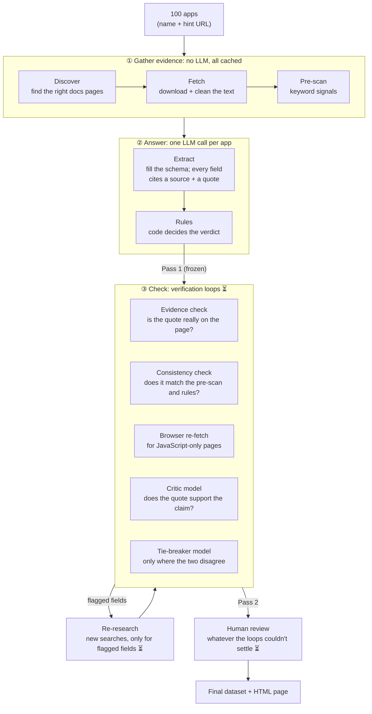

# Composio App Research Agent

**What it does:** before Composio builds a toolkit for an app, someone has to research it. How does it authenticate? Can a developer get credentials alone, or is there a gate? What does the API look like? This agent does that research for **100 apps**. Every answer cites the docs page it came from and a quote from that page. Code checks the answers, then a second model, then a human, and the result is scored against hand-made labels.

**Live page:** ⏳ *(link added at ship time)* · **Data:** [`results/final.json`](results/final.json) · [`results/final.csv`](results/final.csv) ⏳

> Draft. Sections marked ⏳ describe parts still being built. Their numbers are filled in from the pipeline's own output, never typed by hand.

---

## The idea in one picture



**Three ideas run through the design:**
1. **Evidence before answers.** The LLM only sees pages we fetched ourselves, and must quote them. It is never asked to "know" anything.
2. **Code decides what code can decide.** Ranking URLs, keyword signals, the buildability verdict and all statistics are plain Python rules. The LLM only reads docs and fills fields.
3. **Measure, don't trust.** The first answers (**Pass 1**) are frozen. Every loop's effect is measured as Pass 1 → Pass 2 → Final against labels a human made before seeing any agent output.

---

## Following one app through the pipeline

The numbers below are real, from the run for **Linear** (app #73).

| Step | What happens | Linear |
|---|---|---|
| **Input** | Name, category and the hint from the assignment | `Linear`, Productivity, `developers.linear.app` |
| **1. Discover** | Three sources of URLs: the hint, docs-looking links *on* the hint page, and 4 web searches (`… API authentication`, `… developer API docs`, `… API pricing access partner program`, `… MCP server`). Plain rules rank them: official domain **+5**, docs-like words in the path **up to +4**, search relevance **up to +2**, forums and SEO sites dropped. Keep 6. | 6 URLs: the docs home, OAuth 2.0, OAuth actor auth, rate limiting, app manifests, … |
| **2. Fetch** | Download with `httpx` and clean to text with `trafilatura`. Pages that come back thin (JavaScript shells, bot walls) are re-fetched through **Composio → Tavily extract**, which renders JavaScript. | 5 of 6 good. The docs home was a 437-character shell. |
| **2b. Docs bundle** | Cut pages into paragraphs, score each by keyword density (oauth, api key, pricing, partner, rate limit, mcp…), and keep the best within **~3,000 tokens**. Each page's best paragraph is picked first, so every page is represented. | 2,658 tokens from 5 pages |
| **3. Pre-scan** | 19 regex signals over the *full* pages, as an independent second opinion. | oauth2, api_key, bearer_token, graphql, webhooks, rate_limit… |
| **4. Extract** | One call to a Groq model. Every field comes back as `{value, source number, verbatim quote, confidence}`. Code maps the source number back to the exact URL. | ⏳ |
| **Rules** | Code turns access + API type + auth into a verdict: **ready**, **ready with friction** or **blocked**. | ⏳ |
| **5. Verify** | Five loops flag anything unsupported (table below). | ⏳ |
| **6. Re-research** | Flagged fields only: targeted searches, new pages, re-extract, verify again. At most 2 rounds. | ⏳ |
| **7. Human** | Rows the loops couldn't settle get a human decision. Each one is recorded with evidence and listed on the page. | ⏳ |

---

## What we capture per app

Each field holds a **value**, the **URL** it came from, a **verbatim quote** of up to 300 characters, and a **confidence** score.

| Field | Allowed values |
|---|---|
| One-liner | what the app does, in 15 words or fewer |
| Auth methods | `oauth2` · `api_key` · `basic` · `bearer_token` · `jwt` · `hmac_signature` · `other` · `none` |
| Access (self-serve vs gated) | `self_serve_free` · `free_trial` · `paid_plan` · `admin_approval` · `partner_gated` · `contact_sales` · `no_public_api` |
| API type / breadth | `rest` · `graphql` · `soap` · `rpc` · `sdk_or_cli_only` · `none` / small · medium · large |
| MCP server | `official` · `community` · `none_found` (+ URL) |
| Extras | sandbox/test mode, webhooks, rate-limit note, **does Composio already have a toolkit?** |
| Verdict | `ready` · `ready_with_friction` · `blocked`, + main blocker + one-sentence reason |

**Access rule:** when several access levels apply, we record **the most restrictive one you'd hit building a toolkit other people can use**. Example: a free developer account where public OAuth apps need marketplace review is recorded as `admin_approval`.

**Verdict rule (code, not LLM):**
- **ready:** self-serve (free or trial) + a REST or GraphQL API + known auth
- **ready with friction:** paid plan or admin/app review, or SDK/CLI only
- **blocked:** partner programme, contact sales, or no public API

The LLM proposes a verdict too. When it disagrees with the rule, that becomes a verification flag.

---

## How we know the answers are right

### The verification loops ⏳

| Loop | Who checks | What it catches |
|---|---|---|
| **Evidence** | code | The cited URL wasn't fetched or didn't load, or the quote isn't on the page (fuzzy match ≥ 90%) |
| **Consistency** | code | The LLM's verdict ≠ the rule verdict. "OAuth2" claimed but the word never appears in the pages. "Self-serve" claimed but the pages say *partner program*. An official MCP server claimed without an official URL. |
| **Browser** | headless Chromium | Pages that only render with JavaScript, re-fetched and re-extracted |
| **Critic** | a *different* Groq model | For each claim and quote: supported, contradicted, or not enough info? |
| **Tie-breaker** | Gemini (different provider) | Only fields where the extractor and critic still disagree after re-research |

### The accuracy test
- **20 apps**, 2 per category, drawn with a fixed random seed (42), so anyone can reproduce the same sample.
- A human labelled them **by hand from the official docs before any agent output existed**: [`eval/ground_truth.csv`](eval/ground_truth.csv).
- **10 of the 20 are a holdout.** Prompts may be tuned by looking at mistakes on the other 10, never on these. If the holdout score is close to the tuned score, the tuning didn't just overfit.
- Scored per field (auth, access, API type, MCP, verdict) for **Pass 1 → Pass 2 → Final**. Every miss is listed, not just the percentages.

| Field | Pass 1 | Pass 2 | Final |
|---|---|---|---|
| ⏳ | | | |

---

## Results ⏳

*Headline patterns go here, written from the computed numbers. For example: which auth method dominates, which categories are self-serve versus gated, the most common blocker, and easy wins (ready, and no Composio toolkit yet) versus apps that need outreach.*

---

## Where a human was needed

So far (from building the pipeline):
- **Hand labels** for the 20-app accuracy sample.
- **Confirming Composio toolkit matches.** For 76 of 100 apps, a toolkit name or slug matches the app's name exactly. For the rest, close candidates (e.g. `zoho` for Zoho CRM, `whatsapp` for WhatsApp Business) are listed for a person to confirm rather than counted automatically.
- ⏳ Rows flagged `needs_human` after the verification loops. Each override is recorded with its evidence and reason.

---

## Design decisions and why

| Decision | Why |
|---|---|
| **Search through Composio, using our own Tavily key** | Composio's built-in free search toolkit is retired (HTTP 410 on every version), and its "Instant" accounts are a paid setting. Connecting a free Tavily key to Composio keeps the agent on Composio's SDK. See [docs/composio_friction.md](docs/composio_friction.md). |
| **Plain `httpx` first, Composio/Tavily extract as the fallback** | httpx is free and unlimited, and returns a real HTTP status. The evidence check needs that status to answer "did the cited page actually load?". |
| **The model cites a *source number*, not a URL** | Models mangle long URLs, and numbers cost fewer tokens. Code maps each number back to the exact fetched URL. |
| **Verdict by rules, not the LLM** | Consistent across 100 apps, explainable in one sentence, and a free extra check on the LLM. |
| **Extractor and critic are different models** | A model is bad at catching its own mistakes. Extractor: `qwen3.8-27b`. Critic: `gpt-oss-120b`. Tie-breaker: Gemini, a different provider. |
| **~3K tokens of docs per app** | Groq's free tier allows 8K tokens/minute *per request*, so the prompt, docs and answer must fit inside it. That makes picking the right paragraphs important. |
| **Pass 1 is append-only and never rewritten** | It's the "before" in the before/after accuracy comparison. Editing it would hide what the loops fixed. |
| **Everything is cached** (searches, pages, LLM answers) | Re-runs cost no quota, and every number on the page can be regenerated. |
| **Free tiers only** | The whole run costs $0: Composio, Tavily (1,000 searches/month), Groq and Gemini free plans. |

---

## Run it yourself

```bash
python -m venv .venv && source .venv/bin/activate      # Windows: .\.venv\Scripts\activate
pip install -r requirements.txt
cp .env.example .env                                    # add 4 free keys: Composio, Tavily, Groq, Gemini
python -m agent.smoke_test                              # every key and model answers

python -m agent.run --all --prep                        # ① discover + fetch + pre-scan (no LLM)
python -m agent.run --app "Linear" --extract            # ② try one app; prints JSON, writes nothing
python -m agent.run --all --pass 1                      # ② all 100 → results/pass1.jsonl
python -m agent.run --all --verify                      # ③ loops + re-research → pass2.jsonl ⏳
python -m eval.score                                    # accuracy vs hand labels ⏳
```

Runs can be resumed. If a free quota runs out mid-run, the agent stops cleanly; run the same command later and it continues.

---

## Repository map

```
agent/
  composio_client.py   search / extract / toolkit catalogue, all via the Composio SDK
  discover.py          ① find candidate pages and rank them with plain rules
  fetch.py             ① download, clean, Composio fallback, build the docs bundle
  prescan.py           ① keyword signals (independent second opinion)
  extract.py           ② one LLM call per app → validated record
  rules.py             ② the verdict, in code
  llm.py               model fallback chains, rate limits, retries, cache
  run.py               command line
  schema.py            the data model (enums + evidence on every field)
prompts/extract.md     the extraction prompt
eval/                  hand labels + scoring
results/               outputs (pass1, pass2, final, reports)
docs/                  Composio friction log
```

---

## Limitations ⏳

- **Small docs budget.** Each app gets ~3K tokens of docs, the price of a free model tier. A fact sitting in a paragraph that wasn't picked can be missed. The pre-scan reads the full pages to catch some of these.
- **Login-walled or JavaScript-heavy docs** (e.g. PitchBook, DealCloud) may defeat both fetchers. Those rows are marked for a human, not guessed.
- **Provider churn during the build.** Mistral's free API, GitHub Models and Composio's free search toolkit all became unavailable while this was being built. The pipeline was rebuilt around what still works, and the page says so.
